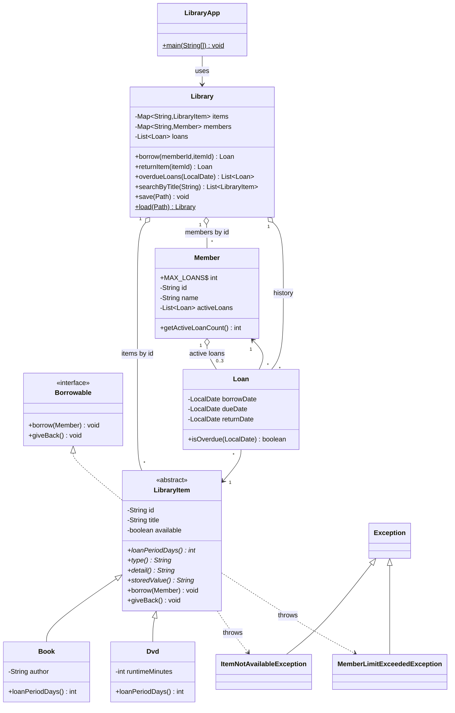

# Library Management System - Class Diagram

## UML (Mermaid - renders in IntelliJ's Markdown preview and on GitHub)



## Plain-text version

```
                     <<interface>>
                     Borrowable
                     + borrow(Member)
                     + giveBack()
                          ^
                          | implements
                  <<abstract>> LibraryItem
                  - id, title, available
                  + loanPeriodDays()*   <- polymorphic
                     ^              ^
          extends    |              |    extends
              Book (14 days)     Dvd (7 days)
              - author           - runtimeMinutes

   Library  ----------------------------------------------+
   - Map<String, LibraryItem> items      (by id)          |
   - Map<String, Member>      members    (by id)          | uses
   - List<Loan>               loans                       |
   + borrow / returnItem / overdueLoans / searchByTitle   v
   + save(Path) / load(Path)  --> items.csv, members.csv, loans.csv

   Loan   : item (LibraryItem), member (Member), borrowDate, dueDate, returnDate
   Member : id, name, activeLoans (max 3)

   Checked exceptions:  ItemNotAvailableException, MemberLimitExceededException   (both extend Exception)
```
